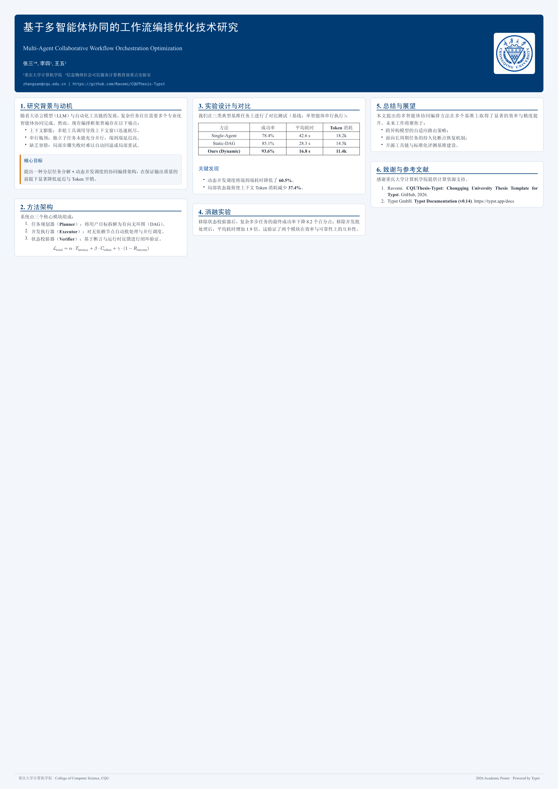

# CQUPoster-Typst

基于 [CQUThesis-Typst](https://github.com/Ravomi/CQUThesis-Typst) 字体与校徽规范设计的**重庆大学学术海报 Typst 模板**，同时配套了可用于 AI Coding Agent 的 `typst-academic-poster` Skill。

## 效果预览



## 特性

- **多尺寸与版式**：支持 `a0` / `a1` / `a2`，支持竖版与横版（`landscape: true`）及 `2 / 3 / 4` 栏布局。
- **双主题配色**：内置 `cqu-blue`（重大蓝）与 `academic-slate`（学术灰蓝）两套主题。
- **模块化组件**：
  - `poster-card(title, body)`：带标题与边框的内容卡片（自动禁止跨栏截断）。
  - `highlight-box(title: none, body)`：用于突出核心结论或关键指标的高亮框。
- **配套 Agent Skill**：位于 `/home/waya/.agents/skills/typst-academic-poster/SKILL.md`，支持自动生成海报、编译 PDF/PNG 并进行视觉防溢出验收。

## 快速开始

### 1. 编译 PDF 与 PNG 预览

```bash
cd /home/waya/CQUPoster-Typst
typst compile main.typ poster.pdf
typst compile --format png --ppi 100 main.typ poster.png
```

### 2. 自定义配置

在 `main.typ` 顶部修改 `cquposter.with(...)` 参数即可：

```typst
#show: cquposter.with(
  paper: "a0",          // "a0" | "a1" | "a2"
  landscape: false,     // true 为横版
  columns-count: 3,     // 2 | 3 | 4
  theme-name: "cqu-blue", // "cqu-blue" | "academic-slate"
  lang: "zh",           // "zh" | "en"
  title: "学术海报标题",
  authors: "张三¹*, 李四¹",
  affiliations: "¹重庆大学计算机学院",
  contact: "email@cqu.edu.cn",
)
```

使用 `#colbreak()` 手动控制分栏换列。

## 目录结构

```text
CQUPoster-Typst/
├── cquposter.typ        # 核心样式、主题与卡片组件
├── main.typ             # 海报内容入口
├── typst.toml           # Typst 包元数据
├── README.md            # 说明文档
└── figures/
    └── CQUbadge.png     # 重庆大学校徽
```

## 相关生态参考

如果希望探索更多社区 Typst 学术海报方案，可参考：
- [peace-of-posters](https://typst.app/universe/package/peace-of-posters)：Typst Universe 热门模块化科研海报包
- [postercise](https://typst.app/universe/package/postercise)：内置多种主题与 `#normal-box` / `#focus-box` 的海报模板
- [simple-research-poster](https://typst.app/universe/package/simple-research-poster)：配合 CeTZ 矢量绘图的轻量多栏模板
- [typst-placard](https://github.com/ant1isbusy/typst-placard)：支持明暗卡片与自动缩放因子的海报包
