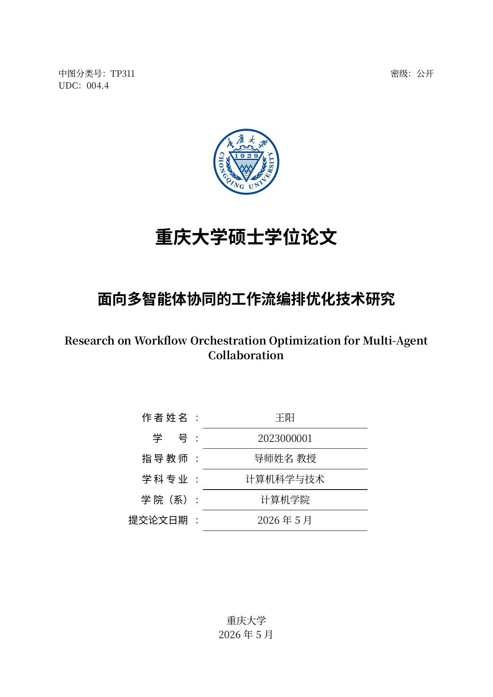

# CQUThesis-Typst：重庆大学毕业论文 Typst 模板

CQUThesis-Typst 表示的是 **C**hong**Q**ing **U**niversity **Thesis** (**Typst** Edition)，转换自 [nanmu42/CQUThesis](https://github.com/nanmu42/CQUThesis)。

本模板是重庆大学毕业论文的 **Typst** 模板，支持学士、硕士、博士论文的排版，旨在以更简洁的标记语法和毫秒级编译速度，减轻毕业论文撰写过程中的排版工作量。

CQUThesis-Typst 根据重庆大学《重庆大学本科设计（论文）撰写规范化要求（2007年修订版）》和《重庆大学博士、硕士论文撰写格式标准（2007年修订版）》编写，力求合规、简洁、易于实现、用户友好。

# 模板特色

* 支持重庆大学本科（`bachelor`）、硕士（`master`，含学术型与专业型 `professional-master`）、博士（`doctor`）的毕业论文格式；
* 内置封面、英文题名页、中英文摘要、目录、插图索引、表格索引、符号说明、致谢、原创性声明与版权授权书等论文部件，可按需自动生成；
* 支持 **盲审模式（`blind-trial: true`）**，自动隐藏作者姓名、学号、导师信息与致谢内容；
* 内置三线表辅助函数（`three-line-table`）及 `GB/T 7714-2015` 顺序编码制参考文献支持；
* 原生 UTF-8 与现代字体支持，无需安装庞大的 TeX Live 发行版，跨平台（Linux / macOS / Windows）开箱即用。



# 用户协议

1. 本模板参考原版 [nanmu42/CQUThesis](https://github.com/nanmu42/CQUThesis)（LaTeX Project Public License 1.3+）转换为 Typst 实现；
2. 截止本文档编辑时，重庆大学教务处和研究生院只提供了毕业论文写作指南，没有提供官方模板，也没有授权或认证任何第三方模板为官方模板。本模板是按照写作指南的参考实现，模板作者自当尽力，但不保证审查老师不提意见。在开始使用前，您同意，任何由于本模板而引起的论文格式审查问题与本模板作者无关。

# 获取与使用

## 下载

```bash
git clone https://github.com/Ravomi/CQUThesis-Typst.git
cd CQUThesis-Typst
```

## 编译

确保已安装 [Typst](https://github.com/typst/typst)（推荐 `0.14+`）：

```bash
# 单次编译生成 main.pdf
typst compile main.typ

# 实时监听文件改动并增量编译
typst watch main.typ
```

推荐使用 VS Code 搭配 `Tinymist Typst` 插件，可获得语法高亮、自动补全与毫秒级实时 PDF 预览。

## 目录结构

```text
CQUThesis-Typst/
├── cquthesis.typ          # 核心模板库
├── main.typ               # 论文主文件（配置封面信息、摘要与章节引入）
├── contents/              # 各章节正文
│   ├── introduction.typ   # 绪论
│   ├── experiment.typ     # 实验参数和流程
│   ├── analysis.typ       # 系统设计与实验分析
│   ├── conclusion.typ     # 结论
│   ├── denotation.typ     # 符号与缩略语说明
│   └── ack.typ            # 致谢
├── figures/               # 图片资源（含重庆大学校徽 CQUbadge.png）
└── ref/
    └── refs.bib           # BibTeX 参考文献库
```

# 提问和支持

* [GitHub Issues](https://github.com/Ravomi/CQUThesis-Typst/issues)
* 原版 LaTeX 模板参考：[nanmu42/CQUThesis](https://github.com/nanmu42/CQUThesis)

# 致谢 / Acknowledgements

这个模板是站在巨人肩膀上的成果，感谢 [nanmu42/CQUThesis](https://github.com/nanmu42/CQUThesis) 提供的重庆大学 LaTeX 论文模板与完整格式规范，感谢 LaTeX 2e 计划、[CTeX 社区](https://github.com/CTeX-org/ctex-kit)、薛瑞尼副教授的 [ThuThesis](https://github.com/xueruini/thuthesis)、[中国科学技术大学 TeX 用户组](https://github.com/ustctug/gbt-7714-2015) 以及 [Typst](https://github.com/typst/typst) 开源社区。

世界因你们更美好。

# 论文写作规范

- [重庆大学本科毕业设计（论文）撰写规范化要求（2007修订）.pdf](https://github.com/nanmu42/CQUThesis/files/644308/2007.pdf)
- [重庆大学博士、硕士学位论文撰写格式标准（2007修订）.pdf](https://github.com/nanmu42/CQUThesis/files/644309/2007.pdf)
- [GB/T 7714-2015 信息与文献 参考文献著录规则.pdf](https://github.com/nanmu42/CQUThesis/files/1096886/GBT.7714-2015.pdf)

# About CQUThesis-Typst

CQUThesis-Typst stands for Chongqing University Thesis Template for Typst, bearing the ability to support bachelor, master, doctor dissertations with grace and speed.
