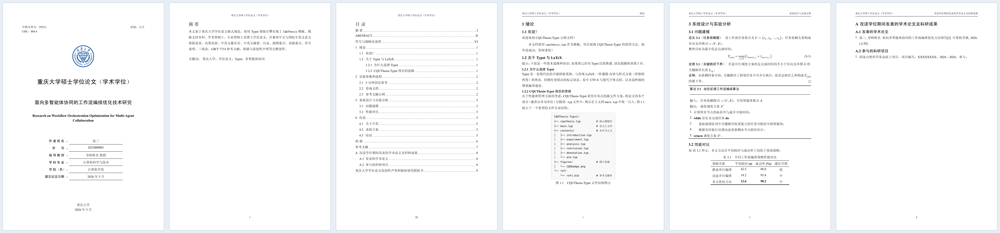

# CQUThesis-Typst：重庆大学毕业论文 Typst 模板（2026）

[](https://typst.app/)
[](https://github.com/Ravomi/CQUThesis-Typst)
[](https://latex-project.org/lppl/lppl-1-3.txt)

**CQUThesis-Typst** 表示的是 **C**hong**Q**ing **U**niversity **Thesis** (**Typst** Edition)。

本模板是重庆大学毕业论文的 **Typst** 模板，支持学士、硕士、博士以及国际生英文论文的排版，旨在以更简洁的标记语法和毫秒级编译速度减轻毕业论文撰写过程中的排版工作量。

CQUThesis-Typst 根据重庆大学现行《重庆大学博士、硕士学位论文格式标准（2023年修订）》与《重庆大学本科毕业设计（论文）撰写规范化要求》编写，力求合规、简洁、易于实现、用户友好。

# 模板特色

* 支持重庆大学**本科**（`bachelor`）、**硕士**（学术型与专业型 `professional-master`）、**博士**（`doctor`）的毕业论文格式；
* 支持**中文论文**（`lang: "zh"`）与**国际生/英文论文**（`lang: "en"`，保留重庆大学要求的中文封面与授权书）；
* 内置封面、英文题名页、中英文摘要、目录、插图索引、表格索引、符号说明、致谢、附录、原创性声明与版权使用授权书，可按需自动生成；
* 支持**盲审模式**（`blind-trial: true`）：自动隐去封面作者/学号/导师信息，并自动省略致谢页与原创性声明/版权授权书；
* 支持**单面/双面打印**（`print-mode: "oneside" | "twoside"`），双面模式下每章自动从奇数页开启；
* 预置三线表辅助函数（`three-line-table`）及 `GB/T 7714—2015` 顺序编码制参考文献支持；
* 附带精选的 AI 论文写作与排版 [`skills/`](skills/README.md) 技能集（支持 Claude Code / Codex / Cursor / Pi / Antigravity）。



# 用户协议

1. 本模板按照 [MIT License](https://opensource.org/licenses/MIT) 开源发布；
2. 截止本文档编辑时，重庆大学教务处和研究生院只提供了毕业论文写作指南，没有提供官方模板，也没有授权或认证任何第三方模板为官方模板。本模板是按照写作指南的参考实现，模板作者自当尽力，但不保证审查老师不提意见。在开始使用前，您同意，任何由于本模板而引起的论文格式审查问题与本模板作者无关。

# 获取与部署

## 下载

| 版本 | 下载地址 | 描述 |
| --- | --- | --- |
| 开发版 | [GitHub 仓库（main 分支）](https://github.com/Ravomi/CQUThesis-Typst) | 推荐，最新的 2026 规范适配与 BugFix |
| ZIP 压缩包 | [点我下载 ZIP](https://github.com/Ravomi/CQUThesis-Typst/archive/refs/heads/main.zip) | 无需 Git，解压即用 |

```bash
git clone https://github.com/Ravomi/CQUThesis-Typst.git
cd CQUThesis-Typst
```

## 编译

无需安装庞大的 TeX Live，仅需安装 [Typst](https://github.com/typst/typst)（推荐 `0.14+`）：

```bash
# 单次编译生成 main.pdf
typst compile main.typ

# 实时监听文件改动并毫秒级增量编译
typst watch main.typ
```

推荐使用 VS Code 搭配 **Tinymist Typst** 插件，可获得语法高亮、跳转与实时 PDF 预览。

## 学位类型与模式配置

在 [`main.typ`](main.typ) 顶部修改 `#show: cquthesis.with(...)` 参数即可切换学位类型与模式：

| 模式 | `main.typ` 配置参数 |
| --- | --- |
| 学术型硕士（默认） | `thesis-type: "master", professional-master: false` |
| 专业型硕士 | `thesis-type: "master", professional-master: true` |
| 博士学位论文 | `thesis-type: "doctor"` |
| 本科毕业论文（设计） | `thesis-type: "bachelor"` |
| 国际生/英文论文 | `lang: "en"` |
| 双面打印 | `print-mode: "twoside"` |
| 盲审模式 | `blind-trial: true` |

# 目录结构

```text
CQUThesis-Typst/
├── cquthesis.typ          # 核心模板库
├── main.typ               # 论文主文件（配置封面信息、摘要与章节引入）
├── contents/              # 各章节正文
│   ├── introduction.typ   # 绪论
│   ├── experiment.typ     # 实验参数和流程
│   ├── analysis.typ       # 系统设计与实验分析
│   ├── conclusion.typ     # 结论
│   ├── denotation.typ     # 符号与缩略语说明
│   └── ack.typ            # 致谢
├── figures/               # 图片资源（含重庆大学校徽 CQUbadge.png 与预览图）
├── ref/
│   └── refs.bib           # BibTeX 参考文献库
└── skills/                # 精选论文写作与排版 Agent Skills
    ├── cqu-thesis-typst/
    ├── academic-writing-zh/
    ├── bibtex-gbt7714-audit/
    └── academic-figures-tables/
```

# AI 论文写作 Skills

仓库内置 [`skills/`](skills/README.md) 目录，包含 4 个精选的论文写作与排版 Agent Skills（标准 `SKILL.md` 格式），涵盖 **重大学位论文 Typst 排版自检**、**中文学术论文写作与去 AI 味润色**、**GB/T 7714—2015 BibTeX 校验** 与 **三线表/公式/图表规范**，可直接复制到 `~/.agents/skills/` 使用。

# 提问和支持

* [GitHub Issues](https://github.com/Ravomi/CQUThesis-Typst/issues)

# 致谢 / Acknowledgements

感谢 [Typst](https://github.com/typst/typst) 开源社区及所有为重庆大学学位论文排版规范做出贡献的开发者：

- **Original upstream**: [nanmu42/CQUThesis](https://github.com/nanmu42/CQUThesis) by Zhennan Li and contributors
- **Modified community baseline**: [yinguoweiOvO/CQU_Thesis2024](https://github.com/yinguoweiOvO/CQU_Thesis2024)
- **International adaptation**: [mishaown/CQUThesis-International-2026](https://github.com/mishaown/CQUThesis-International-2026) by Md Minhazul Islam

世界因你们更美好。

# 论文写作规范（2026 现行参考）

- 《重庆大学博士、硕士学位论文格式标准（2023年修订）》— 请前往 [重庆大学研究生院官网](https://graduate.cqu.edu.cn)「学位工作 / 办事指南」获取最新附件
- 《重庆大学本科毕业设计（论文）撰写规范化要求》— 请前往 [重庆大学本科生院（教务处）官网](https://jwc.cqu.edu.cn) 或所在学院下载专区获取当年最新模板与细则
- 《GB/T 7714—2015 信息与文献 参考文献著录规则》— 可于 [国家标准全文公开系统](https://openstd.samr.gov.cn) 查阅原文

# About CQUThesis-Typst

CQUThesis-Typst stands for Chongqing University Thesis Template for Typst, bearing the ability to support bachelor, master, doctor, and international dissertations with grace and speed.
