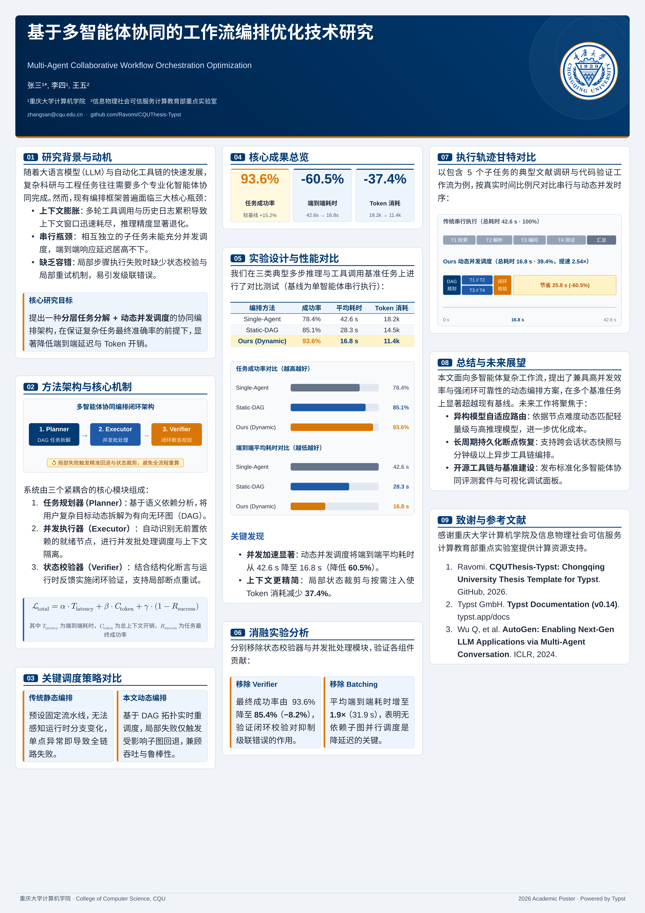

# CQUPoster-Typst（`poster/`）

基于 [CQUThesis-Typst](../README.md) 字体与校徽规范设计的**重庆大学学术海报 Typst 模板**。

## 效果预览



## 特性

- **多尺寸与版式**：支持 `a0` / `a1` / `a2` 自适应字号缩放，支持竖版与横版（`landscape: true`）及 `2 / 3 / 4` 栏布局。
- **双主题配色**：内置 `cqu-blue`（重大蓝）与 `academic-slate`（学术灰蓝）两套主题，搭配渐变横幅、圆形校徽容器与学术三线表自动样式。
- **模块化组件**：
  - `poster-card(title, number: none, body)`：带编号胶囊徽章与分割线的内容卡片（自动禁止跨栏截断）。
  - `highlight-box(title: none, body)`：用于突出核心结论或关键指标的高亮框。
  - `kpi-row(...)` / `stat-card(value, label, sublabel: none, accent: false)`：大号关键数据指标卡组。
  - `formula-box(eq, caption: none)`：带浅色底框与变量说明的公式展示块。
  - `ref-list[...]`：左对齐参考文献容器，避免长英文条目两端对齐产生词距拉宽。

## 快速开始

### 1. 编译 PDF 与 PNG 预览

```bash
cd poster
typst compile main.typ poster.pdf
typst compile --format png --ppi 100 main.typ figures/preview.png
```

### 2. 自定义配置

在 `poster/main.typ` 顶部修改 `cquposter.with(...)` 参数即可：

```typst
#show: cquposter.with(
  paper: "a0",            // "a0" | "a1" | "a2"
  landscape: false,       // true 为横版
  columns-count: 3,       // 2 | 3 | 4
  theme-name: "cqu-blue", // "cqu-blue" | "academic-slate"
  lang: "zh",             // "zh" | "en"
  title: "学术海报标题",
  authors: "张三¹*, 李四¹",
  affiliations: "¹重庆大学计算机学院",
  contact: "email@cqu.edu.cn",
)
```

使用 `#colbreak()` 手动控制分栏换列。

## 目录结构

```text
poster/
├── cquposter.typ        # 核心样式、主题与卡片组件
├── main.typ             # 海报内容入口
├── typst.toml           # Typst 包元数据
├── README.md            # 说明文档
└── figures/
    ├── CQUbadge.png     # 重庆大学校徽
    └── preview.png      # 海报效果预览图
```
